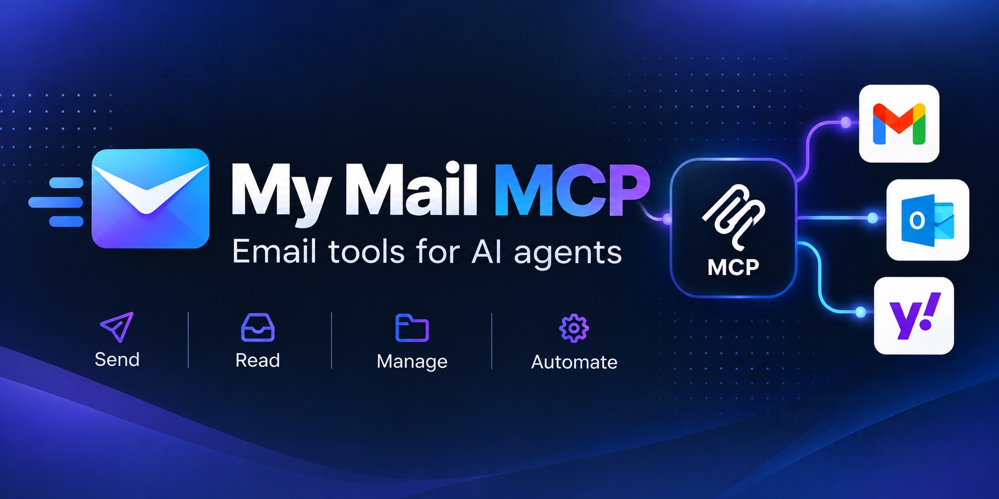

# My Mail MCP



A self-hosted, provider-configurable email MCP server. Yahoo is the initial target.
Built with FastMCP 4.1.3, pinned in `pyproject.toml` and `uv.lock`.
One stateless Python container; no database or application action quota.

## Status: mailbox management preview

Implemented: authenticated Streamable HTTP MCP, health endpoint, folder listing,
paginated text search, reading, flag updates, moving/copying, archiving,
trashing/restoring, permanent deletion, and creating/renaming/deleting user folders.
Message references include folder, UID and UIDVALIDITY to reject stale identifiers.
Attachment metadata is included; attachment downloads are not implemented yet.
Search pagination bounds the returned data, but currently searches all matching UIDs.

Planned: drafts, attachment transfer and GitHub Actions deployment configuration.
OAuth (Auth0 JWT validation) is implemented; see [Auth0 setup](docs/auth0-setup.md).
Cloud Build deployment is configured. Sending is implemented but untested against live Yahoo SMTP. Yahoo reading has been manually verified locally through
VS Code Copilot. Mutation tools have automated coverage but have not been tested
against a live Yahoo mailbox; other providers and Cloud Run remain unverified.

## Tools

With more than one account configured, every tool except `list_accounts` requires an
`account` id (see [Multiple mailboxes](#multiple-mailboxes)); it is optional with one account.

| Tool | Inputs | Behavior |
| --- | --- | --- |
| `list_folders` | optional `account` | Lists folders and IMAP flags |
| `list_accounts` | None | Lists configured account ids and addresses |
| `search_messages` | `folder`, `query`, `limit`, `offset`, optional `since`, `before`, `from_address`, `unread_only` | Filtered search returning uid, subject, from, date and flags; empty query lists messages |
| `read_message` | `folder`, `uid`, `uid_validity` | Reads body and attachment metadata |
| `update_flags` | `folder`, `uids`, `uid_validity`, optional `read`, `starred`, `answered` | Sets chosen flags without replacing others |
| `move_messages` | `folder`, `uids`, `uid_validity`, `destination` | Moves to an existing folder |
| `copy_messages` | `folder`, `uids`, `uid_validity`, `destination` | Copies while retaining originals |
| `archive_messages` | `folder`, `uids`, `uid_validity` | Moves to resolved Archive |
| `trash_messages` | `folder`, `uids`, `uid_validity` | Moves to resolved Trash |
| `restore_messages` | `folder`, `uids`, `uid_validity`, optional `destination` | Moves out of Trash; default destination INBOX |
| `permanently_delete_messages` | `folder`, `uids`, `uid_validity` | Irreversibly deletes specified messages |
| `create_folder` | `folder` | Creates a user folder |
| `rename_folder` | `folder`, `new_name`, `uid_validity` | Renames a user folder without children |
| `delete_folder` | `folder`, `uid_validity` | Deletes an empty user folder without children |
| `send_message` | `to`, `subject`, `body`, optional `cc`, `bcc` | Sends a plain-text email and saves a copy to Sent |
| `reply_message` | `folder`, `uid`, `uid_validity`, `body`, optional `reply_all`, `cc` | Threaded reply quoting the original |
| `forward_message` | `folder`, `uid`, `uid_validity`, `to`, optional `body`, `cc` | Inline forward; attachments are listed, not sent |

Sending is irreversible. Tools advertise `destructiveHint` so clients can ask for
confirmation; the server also limits messages to 20 recipients and rejects header
injection. Set `MAIL_SENT_FOLDER` if the Sent folder is not detected. The sender
is always the configured mailbox.

`since` (inclusive) and `before` (exclusive) take `YYYY-MM-DD` and match whole days in the
mail server's time zone, so "today" is `since=<today>`.
Search returns newest UID first (mailbox arrival order, not necessarily the
message's Date header). Search totals reflect the initial UID snapshot; messages
removed before fetching are omitted and reported in `unavailable_uids`. `limit` is 1–100; use `next_offset` for pagination.
Pass the folder, UID and UIDVALIDITY from search to read a message.
Reads reject messages over 10 MiB and truncate bodies at 100,000 characters,
with `body_truncated` indicating truncation. Reading leaves flags unchanged.

## Modifying a mailbox

Message modifications accept 1–100 distinct positive integer UIDs from the same
folder. Always use a fresh search result's `uid_validity`. Missing UIDs, stale
folder versions, invalid destinations, and read-only folders reject the request
before changing messages. Concurrent mailbox changes can still occur after these checks.

For example, after searching INBOX, call `update_flags` with the returned folder,
UIDVALIDITY, `uids: [<uid>]`, and `read: true` or `starred: true`.
Omitted flag fields stay unchanged. To undo a flag change, explicitly pass `false`.

Archive and Trash are resolved through IMAP special-use flags and standard-name
fallbacks. Set `MAIL_ARCHIVE_FOLDER` or `MAIL_TRASH_FOLDER` if discovery is ambiguous
or fails. These folders must already exist; they are not created automatically.
Trash is recoverable until the provider purges it. Restore uses current UIDs from
Trash and defaults to INBOX; the original folder is not recorded.

Moving changes UIDs. Search the destination again before operating on moved or
copied messages. The result returns `destination` and `refresh_destination: true`;
it deliberately does not reuse source UIDs as destination references.

Moves prefer atomic IMAP MOVE. Servers without MOVE must support UIDPLUS for the
copy/delete/UID EXPUNGE fallback. Permanent deletion always requires UIDPLUS and
expunges only the requested UIDs, never unrelated deleted messages. Unsupported
servers fail before writing. Multi-command operations are not transactions: a
failed move may leave a copy in the destination, and a failed delete may leave
messages marked for deletion. Refresh both folders before retrying; automatic
retries can create duplicates. Copies are also not safe to retry automatically.

Folder renaming and deletion require UIDVALIDITY from a search of the folder
(including empty search results). Detected/configured system folders and INBOX
are protected. Folders with children must be handled from the leaves upward.
Delete checks that a folder is empty first; concurrent deliveries are not locked.
Folder hierarchy delimiters are returned by `list_folders`.

## Local development

Install [uv](https://docs.astral.sh/uv/getting-started/installation/) first.
The project defaults to Python 3.12; uv can download it if needed:

```sh
uv sync --locked
cp .env.example .env
# Edit .env with your own mailbox and a random MCP token of at least 32 characters.
uv run --locked my-mail-mcp
```

uv manages `.venv` automatically; shell activation is unnecessary. Development
dependencies are included by default. Commit `uv.lock` to keep installations
reproducible. To run checks:

```sh
uv run --locked pytest -q
uv run --locked ruff check src tests
```

Add dependencies with `uv add <package>` or `uv add --dev <package>`.
Use `uv lock --upgrade` to intentionally update locked versions.

Never commit `.env`. Generate a token with `openssl rand -hex 32`.
Create a dedicated Yahoo app password in Yahoo Account Security.
The server refuses to start without mailbox credentials and an MCP token, or
when configured with the known placeholder credentials. Replace the GCP
placeholders before deploying.
Clients connect to `/mcp/` with `Authorization: Bearer <MCP_AUTH_TOKEN>`.
`GET /health` checks the process, without connecting to the mailbox.
Bearer authentication is an initial integration option; browser-based connector
OAuth is available for browser-based connectors such as ChatGPT; see
[Auth0 setup](docs/auth0-setup.md).

## VS Code Copilot setup

Start the server separately, then create `.vscode/mcp.json`:

```json
{
  "inputs": [
    {
      "id": "mail-mcp-token",
      "type": "promptString",
      "description": "MCP_AUTH_TOKEN from your local .env",
      "password": true
    }
  ],
  "servers": {
    "my-mail-mcp": {
      "type": "http",
      "url": "http://localhost:8080/mcp/",
      "headers": {"Authorization": "Bearer ${input:mail-mcp-token}"}
    }
  }
}
```

Enter the same token used by the server when prompted. Client configuration
formats vary: the example uses VS Code's `servers` format and interactive inputs.
VS Code also supports portable workspace-root `.mcp.json` configurations with
`mcpServers`, but those do not support VS Code input variables. Local credential-bearing configurations are
ignored by Git. Ask Copilot to list folders, then read your latest email.

## Configuration

| Variable | Default | Purpose |
| --- | --- | --- |
| `MAIL_USERNAME` | Required unless `MAIL_ACCOUNTS` is set | Mailbox login |
| `MAIL_PASSWORD` | Required unless `MAIL_ACCOUNTS` is set | App password; keep secret |
| `MAIL_ACCOUNTS` | Unset | JSON list of mailboxes; takes precedence over the flat `MAIL_*` mailbox settings |
| `MCP_AUTH_TOKEN` | Required, 32+ characters | Client bearer credential |
| `MAIL_IMAP_HOST` | `imap.mail.yahoo.com` | IMAP hostname |
| `MAIL_IMAP_PORT` | `993` | IMAP port, implicit TLS required |
| `MAIL_ARCHIVE_FOLDER` | Auto-detected | Optional exact Archive folder override |
| `MAIL_TRASH_FOLDER` | Auto-detected | Optional exact Trash folder override |
| `AUTH_ISSUER_URL` | Unset | Auth0 issuer (with trailing slash); enables OAuth with `PUBLIC_BASE_URL` |
| `PUBLIC_BASE_URL` | Unset | Public HTTPS base URL; tokens must have audience `<base>/mcp` |
| `PORT` | `8080` | HTTP listening port |
| `MAIL_SMTP_HOST` | `smtp.mail.yahoo.com` | Used for sending |
| `MAIL_SMTP_PORT` | `465` | Used for sending |
| `MAIL_SMTP_STARTTLS` | `false` | Used for sending |

Environment variables take precedence over `.env`. IMAP certificate and hostname
verification remain enabled, using system trust plus Certifi's CA bundle.
The server binds to all interfaces; use localhost for local clients and HTTPS
when exposing it remotely. The bearer credential grants access to this mailbox.

## Multiple mailboxes

Set `MAIL_ACCOUNTS` to a JSON list, on one line in `.env` inside single quotes:

```sh
MAIL_ACCOUNTS='[
 {"id":"yahoo","username":"you@yahoo.com","password":"yahoo-app-password"},
 {"id":"gmail","username":"you@gmail.com","password":"gmail-app-password",
  "imap_host":"imap.gmail.com","smtp_host":"smtp.gmail.com","save_sent_copy":false}
]'
```

Required per account: `id` (letters, digits, `_`, `.`, `-`), `username`, `password`.
Optional: `imap_host`, `imap_port`, `smtp_host`, `smtp_port`, `smtp_starttls`,
`archive_folder`, `trash_folder`, `sent_folder` (defaults match Yahoo) and
`save_sent_copy` (default `true`; set `false` for Gmail, whose SMTP files sent mail itself).

- Call `list_accounts`, then pass `account` to every other tool. Without it the call is
  rejected, so mail is never touched in the wrong mailbox. UIDs are per account.
- At most 3 simultaneous IMAP connections per account; extra requests wait up to a minute.
- Logs show the account id (not the address): `imap account=gmail op=search_messages ...`.
- Moving or copying between accounts is not supported.
- Gmail needs 2-Step Verification and an app password. Its folders are labels
  (`[Gmail]/All Mail`), so archive behaves differently from Yahoo; Gmail has not been
  tested beyond reading, searching and folder listing.

## Container / Cloud Run

```sh
docker build -t my-mail-mcp:local .
docker run --rm --name my-mail-mcp-local --env-file .env -p 127.0.0.1:8080:8080 my-mail-mcp:local
```

Cloud Run supplies `PORT`. Mount `MAIL_ACCOUNTS` and `MCP_AUTH_TOKEN` as Secret Manager
references (a single mailbox is a one-entry `MAIL_ACCOUNTS` list). The service account
needs access only to those secrets. Cloud Run IAM and the application's bearer
authentication are separate layers; client access must be configured accordingly.
[`cloudbuild.yaml`](cloudbuild.yaml) runs checks, builds and pushes to Artifact
Registry, then deploys Cloud Run with Secret Manager references. Follow the
[deployment guide](docs/deployment.md) for one-time setup and GitHub triggers.
Start with the [deployment guide](docs/deployment.md), then enable OAuth with
[Auth0 setup](docs/auth0-setup.md) if you want ChatGPT access.

OAuth for ChatGPT via Auth0 is documented in [Auth0 setup](docs/auth0-setup.md). The
static bearer token keeps working alongside it.

A deployment can serve several mailboxes (see below). Change IMAP settings for another compatible provider;
providers requiring OAuth need an additional authentication implementation.
Yahoo/provider limits and cloud hosting charges still apply.

## Verification and release scope

Tests use mocked mailboxes and do not need Yahoo credentials. CI checks Python
3.11/3.12, lint, formatting, package build, and Docker build. GitHub CI does not deploy or publish. The Cloud Build configuration deploys
when explicitly submitted or attached to a configured trigger. Local Docker validation passed on Linux ARM64: all 68 tests in the builder
container, non-root runtime, HTTP health/authentication, discovery of the tools,
and live Yahoo folder listing. No live mail mutations were tested. Cloud Run
runtime validation remains pending.

This preview exposes read and write operations. Mutation tools advertise their
write/destructive behavior to MCP clients. Permanent deletion is irreversible;
use Trash for recoverable deletion. Email content is untrusted input and must
never be treated as instructions authorizing mailbox changes. No message database is
maintained; content is returned to your MCP client, which controls its own retention.

## License

[MIT](LICENSE).
